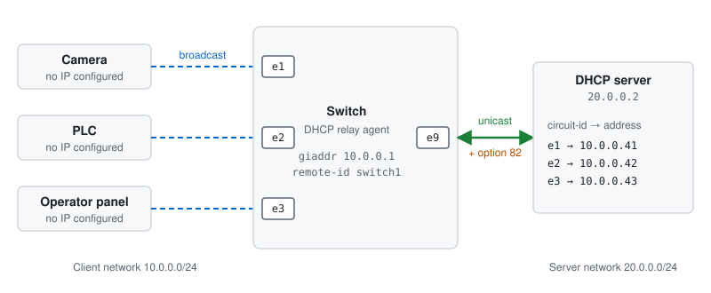
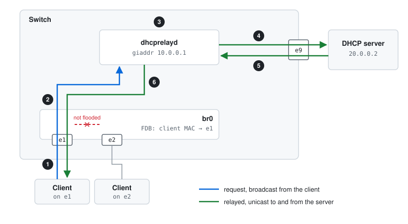
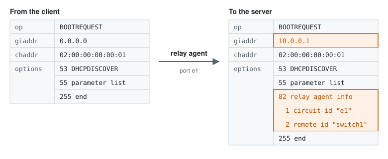

DHCP relay agent w/ Option 82 support
=====================================
[![License Badge][]][License] [![Release Badge][]][Release] [![GitHub Status][]][GitHub]

A DHCP relay agent lets clients on one network get their address from a
DHCP server on another.  Clients find a DHCP server by broadcasting, and
broadcasts stay on the local network.  The relay agent, usually a router
or a switch with an IP address on the client network, picks up the
broadcasts and forwards them as unicast to one or more central DHCP
servers.  It relays the replies back to the clients.

dhcprelayd is a DHCP relay agent with support for option 82, the relay
agent information option from [RFC 3046][].  It can run on a routed
interface, but it is mainly made for a switch: a VLAN aware bridge where
each bridge port connects to one client.


Use case
--------



The relay agent adds option 82 to each request it relays.  The option
tells the server which port the request came in on, the *circuit-id*,
and which relay agent sent it, the *remote-id*.  The server can then
hand out an address per port instead of per MAC address.

This is common in industrial networks: the camera on port e1 always
gets 10.0.0.41.  When the camera is replaced, the new unit gets the
same address without anyone changing the server configuration.


How it works
------------



1. The client broadcasts a DHCPDISCOVER on port e1
2. dhcprelayd reads the request from port e1.  The bridge does not
   forward it: nftables rules drop DHCP requests from the bridge ports,
   so it is not flooded to port e2
3. dhcprelayd sets the gateway address, `giaddr`, to its address on the
   client network and adds option 82
4. The request is sent as unicast to the DHCP server
5. The server sends its reply to `giaddr`, the relay agent
6. dhcprelayd removes option 82, adds an FDB entry for the client on
   port e1 and an ARP entry for the offered address, and sends the
   reply to the client

The FDB entry is for switch cores that do not learn from frames trapped
to the CPU.  Without it the reply would be flooded to every port.


Option 82
---------



The circuit-id defaults to the name of the port the request came in on,
and can be set per port.  The remote-id is the hostname, the `giaddr`,
or a configured string.

A client should never send option 82 itself, it is meant to be added by
a relay agent.  By default the relay agent replaces it with its own, so
a client cannot pick its own circuit-id, and with it, its address.  The
`policy` setting can also keep it, for a trusted downstream device, or
drop such requests.  Requests already relayed by another relay agent,
with `giaddr` set, are always forwarded as they are.  Both can also be given as hex values, see
[String or hex values](#string-or-hex-values).


Getting started
---------------

On a bridge, dhcprelayd needs nftables, both kernel support and the
`nft` tool.

dhcprelayd reads its configuration from `/etc/dhcprelayd.conf`, or the
file given with `-f`.  The simplest configuration looks like this:

```
server 198.19.10.2 {}

interface eth1 {}
```

dhcprelayd listens for DHCP requests on `eth1` and relays them to the
DHCP server at 198.19.10.2, with the first IPv4 address of `eth1` as
the gateway address (giaddr).


Building
--------

dhcprelayd needs [libConfuse][] 3.3 or later and [libev][].  On Debian
and Ubuntu:
```
apt-get install libconfuse-dev libev-dev
```
Build dhcprelayd:
```
./configure && make && make install
```


Configuration
-------------

The file is in [libConfuse][] format: `key = value` settings, and
sections with a name and a body in braces.  Comments start with `#`.
See [simple.conf](examples/simple.conf) for a routed interface, and
[bridged.conf](examples/bridged.conf) for IP address per port on a VLAN
filtering bridge.  The settings are summarized below, the full reference
is the dhcprelayd.conf(5) man page.

**server ADDRESS { }** - DHCP server to relay requests to, at least one,
here or in each interface.  Requests are sent to all servers.
  * **port** - UDP port of the server, default 67

**force-server-identity** - add the server identifier override
sub-option from RFC 5107 to option 82, with the gateway address, so
clients also send their renewals through the relay agent.  The server
must support the sub-option.  Needs the `option82` section.  Default
false.

**udp-listen-port** - also receive requests and server replies on this
UDP port, e.g. from servers or relay agents that use a port other than
67.  Default 67, no extra port

**option82 { }** - add the relay agent information option (82) to each
request, and remove it from replies.  Without this section the option
is not added.
  * **policy** - what to do with a request from a client that already
    carries option 82, default `replace`
    * `replace` - remove the client's option 82 and add our own
    * `keep` - forward the request with the client's option 82
    * `drop` - discard the request
  * **remote-id-type** - `hostname`, default, or `giaddr`
  * **remote-id** - fixed remote-id as text
  * **remote-id-hex** - fixed remote-id as bytes, see below

  Set at most one of the three remote-id settings.

**interface NAME { }** - relay requests received on this interface, at
least one is required
  * **giaddr** - gateway address, sent to the server and used by the
    server to select the subnet.  An IPv4 address, or `auto`, default,
    for the first IPv4 address of the interface
  * **server ADDRESS { }** - servers for this interface, replace the
    global ones
  * **port NAME { }** - bridge port to relay requests from.  Without
    ports, requests are relayed from the interface itself
    * **circuit-id** - circuit-id as text, default the port name
    * **circuit-id-hex** - circuit-id as bytes, see below

The `-hex` settings take colon separated pairs of hex digits, e.g.
`c0:ff:ee`, for values that are not text, including NUL bytes.  Set
either the text or the hex setting, not both.  Values are at most 50
bytes.

A text value with spaces, or with one of `#={}(),+` in it, must be
quoted, e.g. `circuit-id = "cabinet 3"`.


Origin & References
-------------------

dhcprelayd is a fork of [dhcp-helper][] v2.1 by Westermo, which added
Option 82 and bridge support to the original dhcp-helper by Simon
Kelley <simon@thekelleys.org.uk>.  The Westermo project is archived.


[RFC 3046]:        https://www.rfc-editor.org/rfc/rfc3046
[License]:         https://en.wikipedia.org/wiki/GPL_license
[License Badge]:   https://img.shields.io/badge/License-GPL%20v2-blue.svg
[Release]:         https://github.com/kernelkit/dhcprelayd/releases/latest
[Release Badge]:   https://img.shields.io/github/v/release/kernelkit/dhcprelayd
[GitHub]:          https://github.com/kernelkit/dhcprelayd/actions/workflows/build.yml/
[GitHub Status]:   https://github.com/kernelkit/dhcprelayd/actions/workflows/build.yml/badge.svg
[dhcp-helper]:     https://github.com/westermo/dhcp-helper
[libConfuse]:      https://github.com/libconfuse/libconfuse
[libev]:           http://software.schmorp.de/pkg/libev.html
